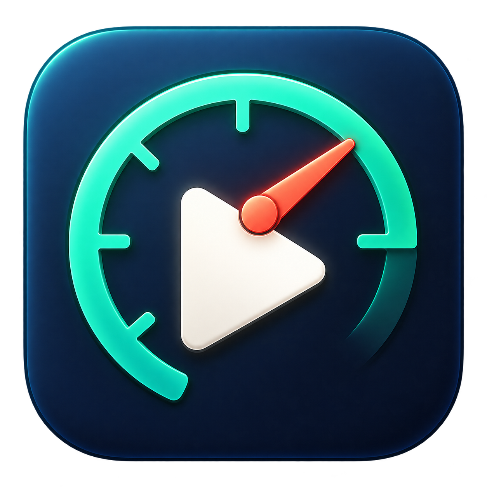

# OpenRaceRender



[](https://github.com/kevinxucs/OpenRaceRender/actions/workflows/ci.yml)
[](LICENSE)

An MIT-licensed, native macOS telemetry video editor, with independent readers and writers for RaceRender 3 projects, layouts, and styles. Built with SwiftUI, AVFoundation, CoreGraphics, and CoreImage. Public builds contain no vendor executable, SDK, artwork, or template library. Local builds can package your installed template library.

This is an evolving implementation. It does **not** have full RaceRender feature or rendering parity. The [feature audit](docs/racerender-feature-audit.md) distinguishes working features from remaining gaps, including limitations of legacy imports.

[Groups and multiple selection](docs/grouping.md) support combined movement/resizing, nested groups, member editing, reusable group templates and timeline changes. Command-click toggles displays, drag empty canvas space for marquee selection, and use Command-G / Command-Shift-G to group / ungroup.

## Build and run

Requires macOS 14 or newer and an installed Xcode toolchain with Swift 5.9 or newer. Builds natively for the host architecture, including Apple silicon.

```sh
git clone https://github.com/kevinxucs/OpenRaceRender.git
cd OpenRaceRender
./scripts/build.sh
./scripts/run.sh
```

The build produces `build/OpenRaceRender.app`, signed locally with an ad hoc signature. You can launch that bundle directly. The application has no third-party package dependencies and does not require a RaceRender installation to run.

In Finder, use **Open With → OpenRaceRender** for an `.rrp` or `.orrp`. File-open requests work at startup and while the app is running, using the same editor and unsaved-change checks as **Open project…**. Imported `.rrp` edits save to a new native `.orrp` unless you explicitly export a compatible RaceRender copy. Opening a telemetry file such as `.rcz` adds it as a data input.

After importing a library, make a self-contained local app with that library:

```sh
./scripts/build.sh --library "$HOME/Library/Application Support/OpenRaceRender/Library"
```

This copies **Templates**, **Styles**, **Images**, and **Video Positions** into `OpenRaceRender.app/Contents/Resources/RaceRender 3`, preserving subfolders and file contents. The browser loads them automatically, including when the app is moved to another directory or the original library is unavailable. A manifest records relative paths and SHA-256 checksums. Your originals are unchanged. These local build resources stay in the ignored `build` directory; a build without `--library` produces a fresh app without them.

The library browser reads `~/Library/Application Support/OpenRaceRender/Library` and packaged resources. Files with matching category and relative path appear once, with user customizations taking priority. **Import library…** copies a selected RaceRender or older OpenRaceRender library into this location without overwriting existing files. **Choose folder…** browses a folder for the current session; **Open library folder** reveals the managed library in Finder.

Documents is never searched automatically, including for migration. On upgrade, import each old library once through the browser, or run:

```sh
./build/OpenRaceRender.app/Contents/MacOS/OpenRaceRender import-library "$HOME/Documents/RaceRender 3"
./build/OpenRaceRender.app/Contents/MacOS/OpenRaceRender import-library "$HOME/Documents/OpenRaceRender"
```

Import the folders you actually have. Originals remain intact for RaceRender. See [library storage and macOS permissions](docs/library-permissions.md) for the location change and code-signing details.

```sh
./scripts/test.sh
```

Optional media acceptance checks require `ffmpeg` and `ffprobe` for test media generation and inspection; the application itself uses native macOS media APIs:

```sh
python3 scripts/validate-media.py
python3 scripts/validate-designer.py
```

## Editing a session

**Setup** in the toolbar guides primary trimming, input synchronization and template selection. It also offers input-bound project length, notes and remembered new-session preferences; see [project setup](docs/project-setup.md).

For multiple cameras, **Sync → Cameras side by side…** offers independent source players and shared-event alignment; see [camera synchronization](docs/source-synchronization.md).

**Edit joined sequence…** arranges clips and inserts adjustable time fillers. Source-list context menus move streams or clips; see [sequence editing](docs/sequences.md).

Data inputs offer recorded-first heading/G-force estimation, explicit calculation modes and source provenance; see [derived motion](docs/derived-motion.md).

When gear data is absent, speed/RPM can provide a labeled estimate with automatic or manual/playhead calibration; see [gear estimation](docs/gear-estimation.md).

Data inputs also offer a previewed column/unit configuration sheet and reusable `.orrd` profiles. Unrecognized CSV clock columns can be assigned before import; see [data profiles](docs/data-profiles.md).

1. Open an `.rrp` or `.orrp`, or add video and telemetry files, including native RaceChrono `.rcz` sessions. Additional cameras start as picture-in-picture displays.
2. Browse templates, styles, images and video-position presets from the bundled or installed library; native `.orrt` layouts also work. Map template inputs to your sources before applying.
3. Select an input to relink it, set its synchronization offset, trim it, change playback rate, delay its start, or join it after the previous media input. **Visual trim…** offers paired frame previews; **Crop / zoom…** offers a draggable pixel rectangle and result preview. Set rotation, mirroring, brightness, contrast, and color here. See [source tools](docs/source-tools.md).
4. Select a display to position and resize it, choose its channel and range, or customize a gauge. **Expanded gauge design** adds dual needles, filled gauges, nonlinear scales, needle geometry, marks, pins, independent captions and color thresholds. Text and shape widgets have dedicated appearance controls. **Automatic** selects the widget's standard field; the inspector shows the matched column or reports an unavailable channel. Peak speed and turn G displays derive their peaks from speed and lateral acceleration. See [channel selection](docs/channel-selection.md). Use **Base settings** for project-wide defaults. Seek to a time and choose **Add at playhead** to create a segment; its field changes are inherited by later segments until overridden. This supports camera switches and timed titles.
5. Use **Sync** to open the data synchronization wizard. Choose a lap start or another event, find the matching frame in its live video preview, and align. Use exact seconds, frame steps, or playback to refine the match. The data input inspector also offers **−1 frame / +1 frame** offset adjustments, alongside the second-based buttons. Frame adjustments use the project's frame rate and account for telemetry playback rate. Under **Data channels & lap timing**, assign channels, create `source × multiplier + offset` fields, or set a GPS finish line at a moving sample. GPS-derived lap times are estimates.
6. The **Objects** timeline shows segment markers. The **Laps** tab seeks to lap starts. Click the current time to jump precisely, and use **In** / **Out** (I/O) to mark the render span. The timeline shades that range. Export the entire project, an explicit range, marked start/end times, or selected laps as H.264 High Profile MP4 with stereo AAC audio. Set video/audio bitrates in the export sheet; video bitrate 0 selects an automatic high-quality rate. Export settings, range and destination are remembered in saved projects. Repeat renders suggest a numbered filename. Save PNG snapshots with the camera button.

Save edits as `.orrp`. For a custom template, choose **Blank** in the library or **Display → Start blank layout**, drag widgets from the palette onto the preview, and edit their settings in the inspector. Choose **Save layout as template…** to check any subset of displays, rename objects and input roles, and include video/audio positions when needed. Parent groups are retained without unselected siblings; group checkboxes select their whole branch. See [subset template export](docs/template-export.md). Templates default to `~/Library/Application Support/OpenRaceRender/Library/Templates`; single-display styles default to `Styles`. Reusable `.orrt` files embed images and gauge backgrounds and remove session media paths, synchronization, data configuration and export state. See the [workflow audit](docs/workflow-audit.md) for the tested stories and gap fixes. Rebuilt `.rrp` export supports representable settings and reports incompatible edits before writing; see [legacy export support](docs/legacy-export.md).

The widget palette offers **Basic widgets**, **Library styles**, and individual widgets from any installed template. Select a template such as your local **Customized - 1** to drag its speedometer, tachometer, peak displays or thermometers into a blank layout. Search by name/style and filter by widget type. **Choose widget style…** in the inspector previews compatible styles while keeping position, size, label, source/channel and timeline. Scripted styles expose automatic/manual ranges, captions, trigger thresholds and their eight script color slots. Use **Align to canvas**, proportional drag resizing, and Option-arrow (one pixel; Shift for ten) for precise placement. Without telemetry, an open palette shows clearly marked design sample values; these never enter saved files or exports. See [template designer validation](docs/template-designer.md).

## Formats

**Apex Telemetry** and **Apex Road** are original built-in templates inspired by motorsport game HUDs. They include 30 editable instruments: speed/RPM/gear, shift lights, throttle/brake, steering and yaw, longitudinal/lateral G, route, completed peak/base speeds and turn G, timing, tyre pressures/temperatures, engine temperatures and GPS/logger metrics. Road mode hides the lap timing instruments. No RaceRender library is required. See [Apex template details](docs/apex-template.md).

```sh
./build/OpenRaceRender.app/Contents/MacOS/OpenRaceRender make-template apex --out Apex.orrt
./build/OpenRaceRender.app/Contents/MacOS/OpenRaceRender make-template apex-road --out Apex-Road.orrt
./build/OpenRaceRender.app/Contents/MacOS/OpenRaceRender make-template apex-gt-road --out Apex-GT-Road.orrt
```

**Apex GT** and **Apex GT Road** move the cluster closer to a simulator HUD: round speedometer/tachometer with needles and redline, a padded TRIP odometer, tall pedal-travel bars, and a top-down car diagram with independently colored wheels and per-corner temperature/pressure readings. Existing digital Apex layouts retain their appearance.

| Format | Support |
| --- | --- |
| `.orrp` | Native JSON project, read/write, including segments, source timing, picture and data settings |
| `.orrt` | Native reusable layout or display style, read/write with input remapping |
| `.rrp` / RRP3 | Structured import and rebuilt export, including added/removed displays, sources, marks and supported timeline/settings records |
| `.rrt` / rrt1, rrt2 | Layout import; RRT2 export with input roles, preview, integrity records and embedded artwork |
| `.rro` / rro1, rro2, rro3 | Style/script/artwork import; RRO2 export for one compatible display |
| CSV / TSV / text | Time column required; RaceChrono preamble, sparse values, quoted cells, interpolation and channel aliases |
| RaceChrono RCZ | Native recorded-session import: independent GPS/CAN/sensor clocks, channel units, recorded laps and resumed fragments; see [RCZ support and validation](docs/rcz-import.md) |
| GPX / TCX | Timestamped track points, GPS and common sensor extensions |
| NMEA | RMC, GGA, GLL, valid fixes, checksum checks when present, merged samples, midnight rollover |
| VBO | Common `[column names]` and `[data]` layouts, UTC time, velocity, signed minute coordinates |
| FIT | Activity record messages, standard GPS/sensor fields, compressed timestamps, both byte orders, CRC validation; unknown/developer fields skipped |
| Video/audio/images | Formats supported by the host's AVFoundation and AppKit decoders; H.264/HEVC MP4/MOV, common audio and images |

Speed units include mph, km/h, m/s, and knots. GPS speed is estimated when absent. Recorded lap numbers, best lap, lap timers, and distance-based delta are supported. Custom finish lines can replace recorded lap boundaries.

Use **Export RaceRender project…** for `.rrp`, or choose a RaceRender format when saving a reusable template/style. Export refuses settings without a verified legacy equivalent; `.orrp`/`.orrt` preserves the full native model. See [legacy export support and validation](docs/legacy-export.md).

## Command line

```sh
./scripts/run.sh inspect session.rrp
./scripts/run.sh inspect-data telemetry.fit
./scripts/run.sh inspect-data session.rcz --time 60
./scripts/run.sh validate-library "$HOME/Library/Application Support/OpenRaceRender/Library/Templates"
./build/OpenRaceRender.app/Contents/MacOS/OpenRaceRender list-library
./scripts/run.sh convert session.rrp --out session.orrp
./scripts/run.sh snapshot session.orrp --time 600 --out frame.png --width 1280
./scripts/run.sh export session.orrp --start 600 --duration 5 --out clip.mp4 --width 1920 --fps 30
./scripts/run.sh export session.rrp --start 600 --duration 5 --out clip-4k.mp4 --width 3840 --fps 59.94005994005994 --video-bitrate 98304 --audio-bitrate 240
./scripts/run.sh export session.rrp --start 0 --duration 1468.70056 --out full-diagnostic.mp4 --width 856 --height 480 --fps 5 --video-bitrate 4000 --progress
./scripts/run.sh --open session.rrp
```

## Compatibility limits

See [render validation](docs/render-validation.md) for the measured quality/performance protocol and local comparison tooling.

RRP3 imports include output markers, project notes/length, source trim/rate/delay/looping, joined streams, inherited timeline changes, crop/rotation/mirroring, picture adjustments, audio balance/channel routing and supported data assignments/calculations. Older native imports recover missing settings from retained legacy data. Specialized effects, some data options and timeline flags remain unsupported and are reported where detected. RaceRender’s application-wide preview/export preferences are not stored in its project file. See [import and designer validation](docs/import-designer-validation.md) for controls, coverage and remaining limits. Imported widgets use saved bitmap aspect ratios, colors, fonts, geometry, original drawing scripts, and full-resolution embedded artwork where supported. Live RaceRender snapshots have been used to correct gauge direction and needles, bars, thermometer labels, RGB blending, maps and lap displays. Persistent Enhanced styles replay their history when seeking or exporting, including recent peak/base speed and completed-turn G-force banners. Legacy Auto activation is enabled; older native imports are repaired once while subsequent native hide edits are retained. All 56 Enhanced styles in the locally tested library render through the bounded interpreter. This establishes coverage, not universal pixel parity: font availability/metrics, replay sampling, gradients and other unsupported effects can still differ.

If a project opens with unavailable inputs, use **Review missing files** and **Relink file…**. Replacements are checked before changing the project, retain synchronization/picture settings, and can be undone. Exports report missing assets used by the selected range; unused sources and embedded artwork do not require their old files. See the [recovery workflow validation](docs/media-recovery-validation.md).

Vendor artwork and scripts are loaded from your local files or an explicitly packaged local library and are not relicensed under MIT. They are excluded from the public repository and default builds. The original product's [license](https://racerender.com/RR3/License.txt) does not provide a general standalone-asset redistribution grant.

360° projection/metadata, stereoscopic compositing, TrackAddict network transfer, camera GPS extraction, full script editing, and several advanced audio/picture controls remain unimplemented. See the audit for details. Parsing all installed templates is a structural compatibility check, not a guarantee of identical rendering.

## Contributing and support

See [CONTRIBUTING.md](CONTRIBUTING.md) for development setup and validation. Report reproducible bugs or propose improvements through [GitHub issues](https://github.com/kevinxucs/OpenRaceRender/issues). Check the [feature audit](docs/racerender-feature-audit.md) for existing limitations and the [changelog](CHANGELOG.md) for development changes.

Please follow the [code of conduct](CODE_OF_CONDUCT.md). For vulnerabilities, follow the [security policy](SECURITY.md). Public reports and contributions should use synthetic examples and omit private media, telemetry, local paths, and proprietary vendor assets.

## Source layout

`Sources/RaceCore` contains file readers, telemetry, timeline/source mapping, rendering, and export. `Sources/OpenRaceRender` contains the desktop editor and CLI. Tests use synthetic interchange records rather than redistributing proprietary templates or private sessions.

## License and attribution

OpenRaceRender's source is available under the [MIT license](LICENSE). Imported third-party files and assets retain their owners' licenses; importing them does not grant redistribution rights.

RaceRender is a product of HP Tuners/RaceRender LLC. OpenRaceRender is an independent project with no affiliation or endorsement.

Graph axes, time windows and saved styles: [2D graph controls](docs/graphs.md). Data-driven artwork: [image controls](docs/image-controls.md).

Widget artwork tools: [background editor](docs/background-editor.md).

Segment controls and navigation: [timeline editing](docs/timeline-editing.md).
